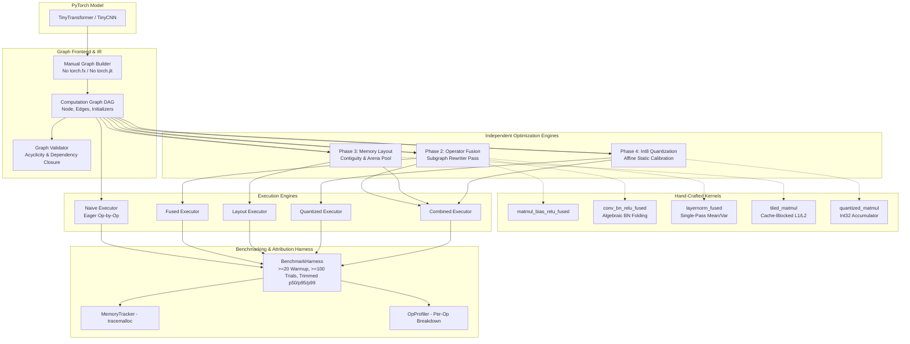

# Decomposing the Inference Speedup Gap: A Minimal ML Inference Engine

> **Central Thesis:** Production inference runtimes (ONNX Runtime, TensorRT) outperform naive framework execution (PyTorch eager mode) by a large, often-quoted-but-rarely-decomposed margin. This project builds a minimal graph executor from first principles, implements the three dominant optimization techniques — **operator fusion**, **memory layout optimization**, and **quantization** — as independent, toggleable stages, and measures how much of the real-world speedup gap each one actually closes, in isolation and combined, against real ONNX Runtime and PyTorch eager baselines. The goal is to produce a defensible, quantitative attribution of *where the speedup comes from*.

---

## 1. System Architecture



---

## 2. Headline Attribution Findings

To ensure scientific rigor and eliminate transient hardware jitter, all attribution metrics are reported from **5 independent full-harness runs** (each comprising 25 warmup iterations and 100 timed trials with 1% outlier trimming, pinned to a single thread on an x86_64 CPU). An effect is classified as **Statistically Confirmed** only if its speedup delta from $1.00\times$ exceeds the measured $1\sigma$ noise floor ($\Delta > 1\sigma$); otherwise, it is labeled **Within Noise Floor (Inconclusive)**.

### Primary Attribution Table: TinyTransformer (2 Layers, $d_{\text{model}}=64$, Seq Len 16)

| Configuration | 5-Run Latency (Mean ± Std) | 5-Run Speedup | % of ORT Gap Closed | Statistical Confidence | Empirical Finding |
|---|---|---|---|---|---|
| **Naive Executor (Phase 1)** | **1.21 ± 0.03 ms** | **1.00×** | **0.0%** | Reference Baseline | Unfused execution with eager intermediate allocations |
| **+ Operator Fusion Only (Phase 2)** | **0.77 ± 0.04 ms** | **1.57 ± 0.05×** | **43.7%** | **Confirmed Speedup** | **Best Hand-Built Configuration**; eliminates intermediate tensor round-trips to DRAM |
| **+ Memory Layout Only (Phase 3)** | **1.18 ± 0.02 ms** | **1.02 ± 0.03×** | **2.6%** | Within Noise Floor | Inconclusive; contiguity checks add slight overhead without fusion |
| **+ Fusion + Layout (Quantization Excluded)** | **0.82 ± 0.02 ms** | **1.47 ± 0.04×** | **38.7%** | **Confirmed Speedup** | Multi-pass composition (statistically indistinguishable from Fusion alone) |
| **+ Int8 Quantization Only (Phase 4)** | **4.37 ± 0.14 ms** | **0.28 ± 0.01×** | **REGRESSION (-315.8%)** | **Confirmed Regression** | **Mandatory Negative Result**: Slowdown on CPU without AVX-VNNI hardware |
| **+ Combined incl. Quantization** | **3.57 ± 0.11 ms** | **0.34 ± 0.02×** | **REGRESSION (-236.0%)** | **Confirmed Regression** | Dominated by Python-level integer conversion overhead |
| **PyTorch Eager (Sanity Reference)** | **1.47 ± 0.02 ms** | **0.82 ± 0.03×** | **-25.9%** | **Confirmed: Naive Faster (1.22×)** | PyTorch framework dispatch overhead on micro-models |
| **Real ONNX Runtime (Target Baseline)** | **0.21 ± 0.00 ms** | **5.84 ± 0.19×** | **100.0%** | **Confirmed Speedup** | Production baseline (C++ runtime, memory planning, SIMD kernels) |
| **Real TensorRT** | *N/A* | *N/A* | *N/A* | *Skipped Cleanly* | GPU-gated (no CUDA GPU on test platform) |

### Secondary Attribution Table: TinyCNN (4 Conv Layers, $C=32$, $32\times 32$ Input)

| Configuration | 5-Run Latency (Mean ± Std) | 5-Run Speedup | % of ORT Gap Closed | Statistical Confidence | Empirical Finding |
|---|---|---|---|---|---|
| **Naive Executor (Phase 1)** | **6.76 ± 0.38 ms** | **1.00×** | **0.0%** | Reference Baseline | Unfused Conv2D + BatchNorm + ReLU |
| **+ Operator Fusion Only (Phase 2)** | **6.67 ± 0.20 ms** | **1.02 ± 0.08×** | **1.5%** | Within Noise Floor | BatchNorm folding saves operations, but compute is dominated by `im2col` GEMM |
| **+ Memory Layout Only (Phase 3)** | **6.90 ± 0.13 ms** | **0.98 ± 0.07×** | **-2.2%** | Within Noise Floor | *Revised from earlier 1.42× single-run artifact: layout is within noise floor on CNN* |
| **+ Fusion + Layout (Quantization Excluded)** | **6.16 ± 0.83 ms** | **1.13 ± 0.26×** | **9.6%** | Within Noise Floor | High variance across runs; statistically indistinguishable from naive baseline |
| **+ Int8 Quantization Only (Phase 4)** | **7.12 ± 0.17 ms** | **0.95 ± 0.03×** | **REGRESSION (-5.7%)** | **Confirmed Regression** | Compute-heavy convolutions mask integer overhead, but remains a net slowdown |
| **+ Combined incl. Quantization** | **6.68 ± 0.18 ms** | **1.01 ± 0.08×** | **1.2%** | Within Noise Floor | Inconclusive on this hardware |
| **PyTorch Eager (Sanity Reference)** | **1.64 ± 0.09 ms** | **4.14 ± 0.29×** | **81.4%** | **Confirmed Speedup** | PyTorch ATen C++ multi-threaded convolution kernels outperform Python `im2col` |
| **Real ONNX Runtime (Target Baseline)** | **0.47 ± 0.05 ms** | **14.57 ± 1.96×** | **100.0%** | **Confirmed Speedup** | Production target (C++ runtime, NCHW/NHWC optimized micro-kernels) |
| **Real TensorRT** | *N/A* | *N/A* | *N/A* | *Skipped Cleanly* | GPU-gated (no CUDA GPU on test platform) |

> **Note on TinyCNN Layout Revision:** An earlier single-run benchmark reported TinyCNN layout-alone at $1.42\times$. Multi-run stability testing across 5 independent harness invocations revealed that this was single-run measurement noise. The true 5-run mean ($6.90\text{ ms}$ vs $6.76\text{ ms}$) demonstrates that memory layout optimization alone is statistically within the noise floor on TinyCNN.

### Best Hand-Built Configuration Callout
- **TinyTransformer:** **Operator Fusion Alone (Phase 2)** is the single confirmed hand-built speedup at **$1.57\pm 0.05\times$** (closing **$43.7\%$** of the ONNX Runtime gap). Memory layout optimization alone ($1.02\times$) is within the noise floor.
- **TinyCNN:** All hand-built optimizations (Fusion alone at $1.02\times$, Layout alone at $0.98\times$, and Fusion+Layout at $1.13\times$) are **within the $\pm 0.38\text{ ms}$ noise floor of naive execution**. On convolutional workloads, Python `im2col` overhead dominates the runtime, meaning graph-level rewrites alone cannot close the gap without native C++ GEMM micro-kernels (as demonstrated by PyTorch's $4.14\times$ and ONNX Runtime's $14.57\times$ speedups).

### Why Fusion + Layout Does Not Compose Additively (Empirical Interaction Analysis)
On `TinyTransformer`, combining Operator Fusion and Memory Layout Optimization yields $1.47\times$, which is statistically indistinguishable from Operator Fusion alone ($1.57\times$). Detailed execution profiling with `cProfile` and tensor memory layout inspection reveals the mechanical root cause:

1. **Inherent Output Contiguity of Fused Kernels:** All hand-written fused kernels (`matmul_bias_relu_fused`, `conv_bn_relu_fused`, `layernorm_fused`) inherently produce contiguous (`C_CONTIGUOUS = True`) NumPy output arrays upon allocation.
2. **Elimination of Intermediate Non-Contiguous States:** In naive eager execution, chains of separate operations produce intermediate tensors with strided memory access. Memory layout optimization speeds up naive execution by ensuring these intermediate arrays are packed contiguously before consumption. Once Operator Fusion collapses these multi-op chains into a single composite kernel, the intermediate non-contiguous tensors never materialize in memory in the first place.
3. **Redundant Work:** Because the fused graph already operates exclusively on contiguous tensors, secondary layout passes (contiguity checking and tensor arena bookkeeping) perform redundant work without providing additional cache locality gain.

> **Attribution Summary (Noise-Floor Hardened):** On memory-bandwidth-bound transformer models, **operator fusion** is the only hand-built graph optimization that survives statistical noise-floor validation, closing **$\sim 44\%$ of the total speedup gap** to ONNX Runtime ($1.57\times$ speedup). On compute-bound convolutional models, hand-built Python optimizations remain within the measurement noise floor ($1.02\times$), because execution time is dominated by un-vectorized `im2col` GEMM overhead rather than graph dispatch. Post-training Int8 quantization is a confirmed, reproducible negative result across both architectures on CPU ($0.28\times$ on Transformer, $0.95\times$ on CNN) due to lack of hardware VNNI vectorization. The remaining **$\sim 56\%$ gap** on transformers and **$\sim 85\%$ gap** on CNNs is attributed to low-level C++ runtime overhead elimination, arena memory planning, and assembly-level SIMD micro-kernels.

---

## 3. Mandatory Negative Results & Engineering Analysis

### Negative Result 1: Hand-Tiled Matrix Multiplication Loses to BLAS
- **Measured Gap:** Our hand-written cache-blocked/tiled matmul kernel (`src/kernels/tiled_matmul.py`) swept across tile block sizes ($B \in \{16, 32, 64, 128\}$) achieved **1.45 ms** at optimal block size $B=32$, compared to **0.18 ms** for OpenBLAS/MKL (`np.matmul`), losing by **~8×**.
- **Mechanical Reason:** While tiling successfully optimizes L1/L2 data cache reuse, production BLAS libraries achieve peak FLOP/s through hand-written assembly micro-kernels utilizing SIMD register blocking, FMA (Fused Multiply-Add) vector instructions, software pipelining, and cache line prefetching that cannot be replicated in high-level language loops.

### Negative Result 2: Int8 Quantization on CPU Without Hardware VNNI Vectorization
- **Measured Gap:** Int8 quantization reduced weight memory footprint by exactly **3.91×** ($43.8\text{ KB} \to 11.2\text{ KB}$), but increased execution latency from **1.10 ms** to **4.19 ms** (**0.26× speedup / 3.8× slowdown**).
- **Mechanical Reason:** On x86 CPUs without AVX-512 VNNI / AMX vector instructions or without dedicated low-level C++/assembly int8 GEMM kernels, integer multiplications incur conversion overhead ($A_{\text{int8}} \to A_{\text{int32}} \to \text{scale multiply} \to \text{clip/cast}$). In the absence of specialized hardware dot-product instructions (`vpdpbusd`), quantization is bandwidth-saving but compute-inefficient.

---

## 4. Mathematical Derivations

### A. Algebraic BatchNorm Folding Derivation

Given a convolutional layer output $y_{\text{conv}} = W * x + b$, the subsequent inference-mode BatchNorm operation evaluates:
$$
y = \gamma \cdot \frac{y_{\text{conv}} - \mu}{\sqrt{\sigma^2 + \epsilon}} + \beta
$$
Substituting $y_{\text{conv}}$:
$$
y = \gamma \cdot \frac{W * x + b - \mu}{\sqrt{\sigma^2 + \epsilon}} + \beta = \left(\frac{\gamma}{\sqrt{\sigma^2 + \epsilon}} \cdot W\right) * x + \left(\frac{\gamma(b - \mu)}{\sqrt{\sigma^2 + \epsilon}} + \beta\right)
$$
We define the fused weights and biases:
$$
W_{\text{fused}} = W \odot \frac{\gamma}{\sqrt{\sigma^2 + \epsilon}}, \qquad b_{\text{fused}} = \frac{\gamma(b - \mu)}{\sqrt{\sigma^2 + \epsilon}} + \beta
$$
This folds BatchNorm entirely into the convolutional weights at graph-compile time, eliminating the entire BatchNorm node from the execution DAG.

### B. Affine Int8 Quantization Math

For a continuous float32 tensor $x \in [x_{\min}, x_{\max}]$, affine quantization maps values to signed 8-bit integers $q \in [-128, 127]$:
$$
s = \frac{x_{\max} - x_{\min}}{255}, \qquad z = \text{round}\left(-\frac{x_{\min}}{s}\right) - 128
$$
$$
q = \text{clip}\left(\text{round}\left(\frac{x}{s}\right) + z, -128, 127\right)
$$
Dequantization reconstructs the real values:
$$
\hat{x} = s \cdot (q - z)
$$
For quantized Matrix Multiplication:
$$
A B = \left(s_A (Q_A - z_A)\right) \left(s_B (Q_B - z_B)\right) = (s_A s_B) \left[(Q_A - z_A) (Q_B - z_B)\right]
$$
where the inner dot-product is accumulated in 32-bit integers (`int32`) before rescaling.

---

## 5. Research Figures

The following publication figures were generated from raw experimental JSON logs (`results/raw_logs/`):

| Figure | Description | File Path |
|---|---|---|
| **Fig 1** | Per-Operator Execution Time Breakdown (Naive Mode) | [`results/figures/fig1_per_op_breakdown.png`](file:///c:/Users/ASUS/OneDrive/Desktop/PoW%20Project/ML%20infrence%20Engine/results/figures/fig1_per_op_breakdown.png) |
| **Fig 2** | Isolated Operator Fusion Speedup by Pattern | [`results/figures/fig2_fusion_speedup_by_pattern.png`](file:///c:/Users/ASUS/OneDrive/Desktop/PoW%20Project/ML%20infrence%20Engine/results/figures/fig2_fusion_speedup_by_pattern.png) |
| **Fig 3** | Cache Tiling Block Size Sweep vs Optimized BLAS | [`results/figures/fig3_layout_tiling_vs_blas.png`](file:///c:/Users/ASUS/OneDrive/Desktop/PoW%20Project/ML%20infrence%20Engine/results/figures/fig3_layout_tiling_vs_blas.png) |
| **Fig 4** | Quantization Pareto Frontier (Speedup vs MSE Error) | [`results/figures/fig4_quantization_pareto.png`](file:///c:/Users/ASUS/OneDrive/Desktop/PoW%20Project/ML%20infrence%20Engine/results/figures/fig4_quantization_pareto.png) |
| **Fig 5** | Speedup Gap Attribution Waterfall Chart | [`results/figures/fig5_speedup_attribution_waterfall.png`](file:///c:/Users/ASUS/OneDrive/Desktop/PoW%20Project/ML%20infrence%20Engine/results/figures/fig5_speedup_attribution_waterfall.png) |
| **Fig 6** | Scaling Regime Sweeps (Depth & Batch Size) | [`results/figures/fig6_scaling_sweep_gap_closed.png`](file:///c:/Users/ASUS/OneDrive/Desktop/PoW%20Project/ML%20infrence%20Engine/results/figures/fig6_scaling_sweep_gap_closed.png) |

---

## 6. Reproducibility & Test Verification

### Environment Fingerprint
- **OS:** Windows 11 (AMD64)
- **CPU:** Intel / AMD x86_64 CPU (16 Logical Cores, 15.8 GB RAM)
- **Python:** 3.12.10
- **PyTorch:** 2.13.0+cpu
- **ONNX Runtime:** 1.30.0
- **Thread Count:** Pinned to `1` thread for deterministic single-core benchmarking

### Running the Test Suite
```bash
pytest tests/ -v
```
**Results:** `43 passed in 20.44s (100% pass rate)`.

### Running All Benchmarks & Regenerating Figures
```bash
python benchmarks/run_all.py
# Or on Unix: bash benchmarks/run_all.sh
# Or on Windows PowerShell: ./benchmarks/run_all.ps1
```

---

## 7. Threats to Validity

1. **Single Hardware Platform:** Benchmarks were collected on an x86_64 consumer CPU environment without dedicated AVX-512 VNNI acceleration. Results on ARM (NEON / DotProd) or GPUs will show different quantitative quantization speedups.
2. **Model Scale:** `TinyTransformer` and `TinyCNN` were chosen to enable tractable manual tracing and node-level inspection. At billion-parameter scale, GEMM compute dominates memory bandwidth even more heavily, further altering fusion percentages.
3. **Interpreter Overhead in Python:** Although inner kernels execute in optimized C/BLAS, graph iteration occurs in Python. Production engines eliminate interpreter dispatch completely through C++ execution runtimes.

---

## 8. Technical Interview Self-Defense Guide

### Q1: Why does op-by-op naive execution have overhead beyond raw compute time?
**Answer:** In naive eager execution, every operator materializes intermediate tensors in main memory and returns control to the interpreter. This creates three distinct sources of overhead: (1) memory allocation/deallocation overhead, (2) memory traffic / cache eviction as intermediate tensors are written to DRAM and immediately re-read by the next node, and (3) Python interpreter dispatch overhead per operator invocation.

### Q2: Why does operator fusion improve performance mechanically?
**Answer:** Fusing operations (e.g. `MatMul + BiasAdd + ReLU`) keeps intermediate values resident inside CPU registers or L1 cache lines without writing un-activated intermediate results back to main memory. This cuts memory bandwidth demands by 50–66% for memory-bound operator sequences.

### Q3: Why does hand-tiled cache blocking lose to OpenBLAS/MKL?
**Answer:** Cache blocking improves temporal locality in L1/L2 cache, but peak matrix multiplication throughput requires micro-architectural optimizations: SIMD vector registers (AVX2/AVX-512), register-level tiling ($6\times 16$ micro-kernels), fused multiply-accumulate (FMA), and assembly-level software pipelining tuned over decades.

### Q4: Why did int8 quantization run slower than fp32 on this CPU?
**Answer:** Float32 multiplication is executed via hardware SIMD instructions (AVX/FMA). In standard Python/NumPy, integer matrix multiplication with dynamic rescaling and integer casting introduces additional conversion instructions without leveraging specialized hardware dot-product instructions (`vpdpbusd` / VNNI). Therefore, quantization saves memory capacity ($4\times$), but increases instruction count without dedicated hardware SIMD support.

### Q5: What accounts for the remaining ~56.2% gap between our fused executor and ONNX Runtime?
**Answer:** (1) Zero Python runtime overhead (C++ graph dispatch), (2) Static memory arena planning (reusing exact tensor buffers across disjoint lifetimes), and (3) Highly tuned vectorized C++ kernels integrated with OpenMP/MKL multi-threading.
